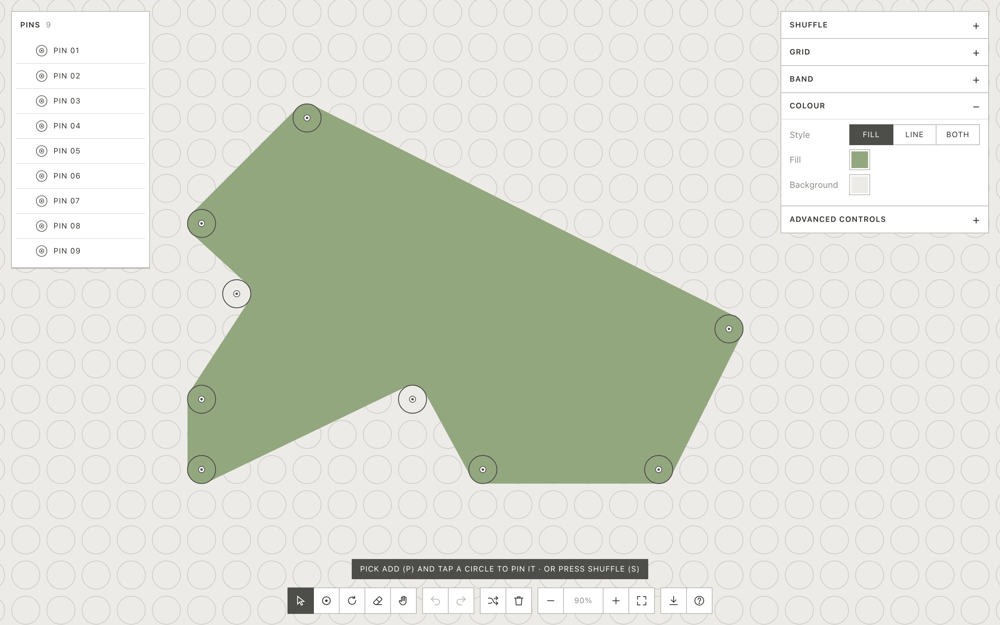
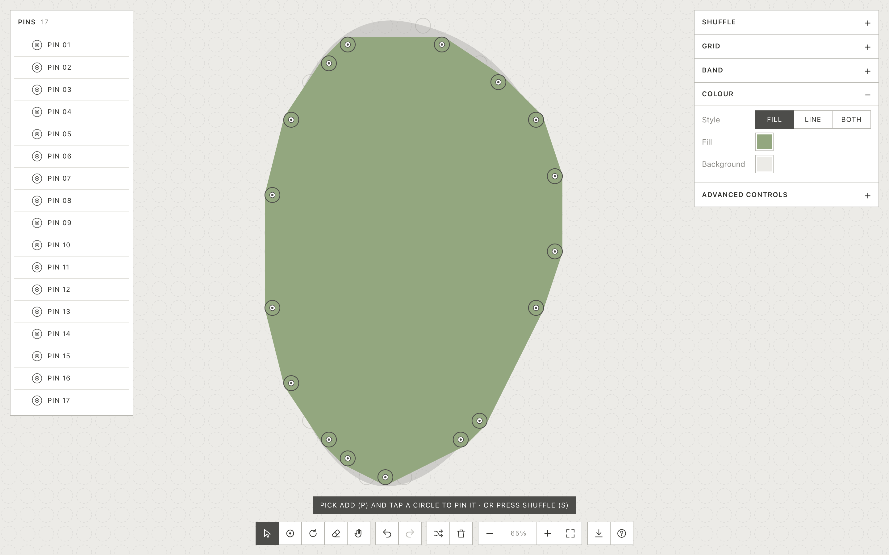

# Rubber Band Generator

> [!NOTE]
> **This repository is a read-only public mirror.** The Rubber Band Generator is now developed
> in a private collection of graphic tools, and each update is pushed here with its full history.
> Issues are welcome here. Pull requests can't be merged directly, but the changes they propose
> can be carried over by hand.

A playground for Armin Hofmann's **rubber band forms**: pin circles on an endless grid, and a taut
band wraps around them, resolved into one closed path of arcs and tangent lines.

One HTML file. No build step, no dependencies, no network. Open it and it runs.



---

## Quick start

```bash
git clone git@github.com:rosstopherkeen/rbg-armin.git
open rbg-armin/index.html
```

Or just download `index.html` and double-click it. That is the entire installation.

---

## What it is

Armin Hofmann's rubber band shapes come from a simple physical idea: drive pins into a board,
stretch a rubber band around them, and the band finds its own form — straight where it spans,
curved where it wraps. Change a pin's position or thickness and the whole silhouette
reorganises.

This tool lets you play with that directly. Tap circles on the grid to pin them, drag them, make
them bigger or smaller, and flip the band around a pin or tuck it in, and watch the shape
re-form as you go. Underneath, it is real geometry rather than drawing by eye: every segment
between two pins is solved as a tangent line, every pin is an arc the band actually wraps, and
the result is a single path you can export and cut, plot, or print.

The algorithm follows the approach worked out in
[this Processing forum thread](https://discourse.processing.org/t/shape-generator-help-armin-hofmanns-rubber-band-shape-generator/33190).

---

## How it works

A band segment between two pins is the **belt-and-pulley tangent problem**. Pin `i` has a centre
`c`, a radius `r`, and a wrap sign `s` (`+1` = increasing angle in screen coordinates). For pins
A and B:

```
k     = s_a*r_a - s_b*r_b
L     = sqrt(D^2 - k^2)              D = |B - A|,  requires D >= |k|
theta = atan2(dy, dx) + atan2(k, L)        tangent direction
u     = (sin theta, -cos theta)            normal
P_a   = A + r_a*s_a*u                      tangent point on A
P_b   = B + r_b*s_b*u                      tangent point on B
```

Each pin then gets an arc from its incoming tangent point to its outgoing one, swept in the
direction of `s`. The same numbers drive the canvas `arc()` and the SVG `A` command
(`sweep-flag = s > 0`), so what you see and what you export cannot drift apart.

**Wrap signs default to auto:** `s_i = sign(cross(p_i - p_{i-1}, p_{i+1} - p_i))` — the turn
direction at that pin. Corners that stick out get the band **around** them; dents get it
**tucked in**. Flip any pin by hand to override it.

**When `D < |k|` no tangent exists** — one circle swallows the other for that combination of
signs. That pair is linked by a red dashed line, and the pins panel says so in plain words.
Move the pins apart, make one smaller, or flip one.

Everything is computed as a pipeline:

```
grid  ->  mask  ->  pin selection  ->  ordering  ->  band solve
```

Changing a mask threshold invalidates everything downstream of the mask; changing a colour or
**Grow pins by** invalidates only the final solve.

---

## The interface

The canvas is an endless grid of circles, each one a spot you can pin. Scroll to move around;
⌘ + scroll or pinch to zoom. Everything else floats on top:

- **The toolbar** (bottom centre) holds the tools and the everyday actions: Select, Add, Flip,
  Erase, Pan · undo, redo · Shuffle, Clear · zoom, fit · import / export · how it works. Hover any
  button for its name and shortcut.
- **The pins panel** (left) lists the pins in band order. Click to select, drag ⠿ to change the
  order, ✕ to remove.
- **The design panel** (right) shows the selected pin (its size, and whether the band goes
  around it, tucks in, or decides on its own), then Shuffle, Grid, Band and Colour. Everything
  else — lattice, stagger, jitter, band order, the mask, export padding — is under
  **Advanced Controls**.

Pins are drawn as marks on a drawing: a hairline ring with a node at the centre. A dot in the
node means auto, a solid node means around, an open ring means tucked in. Select a pin and a
knob appears on its rim; drag it to resize.

### Masks

Under **Advanced Controls → Mask**, load a solid black SVG or PNG and the grid obeys it. The image
sits centred on the canvas origin at its own size; move it with **Position**, size it with
**Scale**. Ink coverage is sampled per circle as `alpha × (1 − luminance)`, so black-on-white and
black-on-transparent both read as solid; invert for white-on-black art. Two roles, independently
toggleable:

- **Select** — a circle can be pinned only where coverage exceeds the threshold.
- **Density** — circles are dithered out by coverage:
  `p = clamp((v − (thr − feather)) / 2·feather) × density`, compared against a per-circle seeded
  random. Deterministic, so re-rolling the seed changes the scatter and nothing else.



### One undo

⌘Z and ⇧⌘Z (and the toolbar arrows) step back and forward through everything in the order you
did it: pin edits and settings alike.

---

## Controls

| input | action |
|---|---|
| `V` | Select: click a pin to select, ⇧-click to add or remove, drag empty space for a box |
| `P` | Add: click an empty circle to pin it; stays in Add so you can keep going |
| `F` | Flip the selected pins (around ↔ tucked in); with nothing selected, the Flip tool |
| `E` | Erase: click or drag over pins to remove them |
| `H` · space-drag · middle-drag | pan |
| drag a pin | move it (moves the whole selection) |
| drag the knob on a pin's rim | resize |
| ⌥-drag a pin | drag a copy |
| arrow keys · ⇧ + arrows | nudge the selection one grid step · five |
| ⌘A | select all pins |
| ⌫ | remove the selected pins |
| `Esc` | close a menu · back to Select · deselect · cancel a drag |
| right-click | Flip / Remove on a pin; Select all / Shuffle / Fit / 100% on the canvas |
| `S` | Shuffle: new random pins |
| scroll · ⌘ + scroll or pinch | pan · zoom |
| ⌘+ / ⌘− · ⇧1 · ⇧0 | zoom · fit the shape · 100% |
| ⌘Z / ⇧⌘Z | undo / redo |
| ⇧⌘E · ⌘O | import / export menu · import a project file |
| ⌘\ | show / hide the panels |
| `?` | how it works |

---

## Import and export

Your work autosaves in the browser and comes back when you reopen the page.

The **import / export** menu in the toolbar has:

- **SVG (vector)** and **PNG image** — artwork out, cropped to the band plus the padding set under
  Advanced Controls, with no UI. The SVG is a single `<path>` of `A` and `L` commands, ready for
  Illustrator or a plotter.
- **Project file (.json)** — the whole state, mask image included as a data URL, so a file is
  self-contained and portable. **Import** loads one back; files from older versions of the tool
  open too.

---

## Examples

Open these with **import / export → Import**:

| file | shows |
|---|---|
| [`01-blob-mask`](examples/01-blob-mask.band.json) | a mask driving both roles — select carves the silhouette, density dithers the field — with outline-ordered pins tracing the edge |
| [`02-hex-field`](examples/02-hex-field.band.json) | hex lattice, eleven random pins with a minimum spread, drawn as a heavy line |
| [`03-radial-tour`](examples/03-radial-tour.band.json) | radial lattice with varied sizes, nearest-next ordering, and an open band rather than a closed one |

The first one embeds its own mask, so it loads complete.

---

## Making it yours

Colours, spacing and sizes are CSS custom properties in the `:root` block at the top of
`index.html`. The band, pin and canvas colours are in the Colour panel and travel with each
project file.

---

## Browser support

Works in any current browser, straight from `file://` — no server needed.

---

## Why not a desktop or terminal app?

**Terminal: no.** This is direct manipulation of continuous geometry — drag a pin onto a circle,
drag its rim, box-select, watch the arcs re-solve as you zoom. A TUI gives you character cells;
you would be typing coordinates at a preview you cannot trust.

**Tauri or Electron: packaging, not capability.** A wrapper would add a dock icon, native menus,
and a file association. It would also add a Rust or Node toolchain, a build step, per-platform
packaging, code signing and notarization for distribution, and a CI matrix — on a tool that is
currently one file you double-click. The web platform already covers the real needs: canvas for
rendering, file import and download, `localStorage` for autosave.

If the dock icon ever becomes worth it, Tauri wraps `index.html` unchanged. Nothing here has to
be rewritten for that to happen, which is exactly why it can wait.

---

## Known limits

- **Self-intersections are detected, not fixed.** When straight segments cross, the pins panel
  says so; most band orders avoid it, but a hand-ordered band that crosses itself renders as
  authored.
- **Mask roles `radius` and `route` are not implemented** — radius-from-coverage needs a distance
  transform, contour routing needs marching squares.
- **Pins bigger than the gap between them produce tangent errors by construction.** That is the
  `D >= |k|` condition doing its job, not a bug.

---

## License

MIT — see [LICENSE](LICENSE).

Armin Hofmann's work is the source of the form language; this is a tool for exploring it, not a
reproduction of his designs.

<br/>

<p align="center">
  <picture>
    <source media="(prefers-color-scheme: dark)" srcset="./docs/brand/gandaberunda-white.png" />
    
  </picture>
  &nbsp;
  <picture>
    <source media="(prefers-color-scheme: dark)" srcset="./docs/brand/made-in-bengaluru-white.png" />
    
  </picture>
</p>
