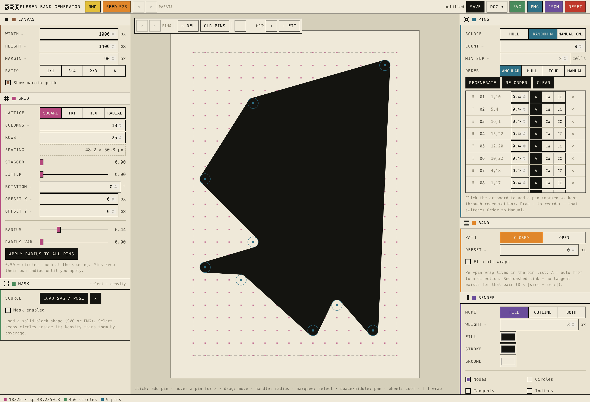
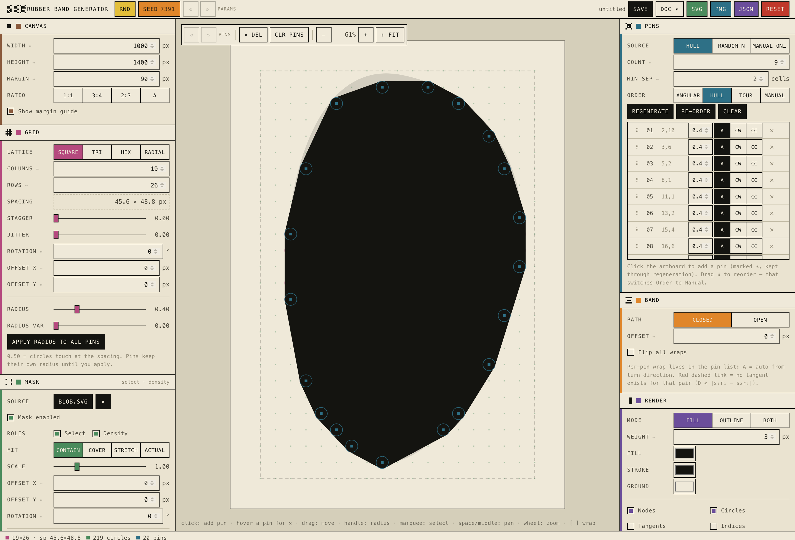
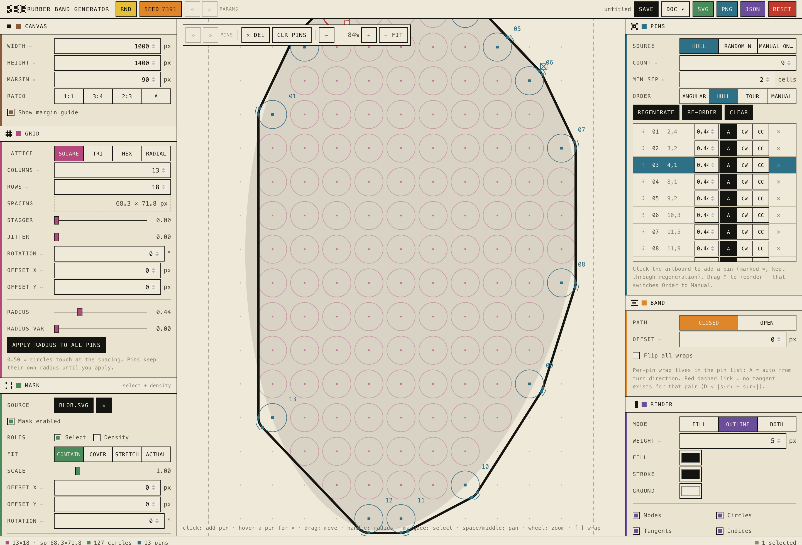
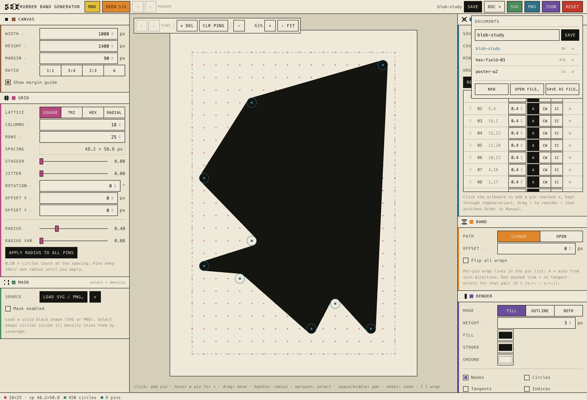

# Rubber Band Generator

A shape generator for Armin Hofmann–style **rubber band forms**: circles on a grid, a taut band
wrapped around a chosen few, resolved into one closed path of arcs and tangent lines.

One HTML file. No build step, no dependencies, no network. Open it and it runs.



---

## Quick start

```bash
git clone git@github.com:rosstopherkeen/rbg-armin.git
open rbg-armin/index.html
```

Or just download `index.html` and double-click it. That is the entire installation.

---

## What it is

Armin Hofmann's rubber band shapes come from a simple physical idea: drive pins into a board,
stretch a rubber band around them, and the band finds its own form — straight where it spans,
curved where it wraps. Change a pin's position or thickness and the whole silhouette
reorganises.

This tool does that with real geometry rather than by eye. Every segment between two pins is
solved as a tangent line; every pin is an arc the band actually wraps. The result is a single
path you can export and cut, plot, or print.

The algorithm follows the approach worked out in
[this Processing forum thread](https://discourse.processing.org/t/shape-generator-help-armin-hofmanns-rubber-band-shape-generator/33190).
The interface borrows its visual language — cream ground, monospace, hairlines, flat colour
chips — from Giorgio Sancristoforo's [*Ooame*](https://www.giorgiosancristoforo.net/ooame/).

---

## How it works

A band segment between two pins is the **belt-and-pulley tangent problem**. Pin `i` has a centre
`c`, a radius `r`, and a wrap sign `s` (`+1` = increasing angle in screen coordinates). For pins
A and B:

```
k     = s_a*r_a - s_b*r_b
L     = sqrt(D^2 - k^2)              D = |B - A|,  requires D >= |k|
theta = atan2(dy, dx) + atan2(k, L)        tangent direction
u     = (sin theta, -cos theta)            normal
P_a   = A + r_a*s_a*u                      tangent point on A
P_b   = B + r_b*s_b*u                      tangent point on B
```

Each pin then gets an arc from its incoming tangent point to its outgoing one, swept in the
direction of `s`. The same numbers drive the canvas `arc()` and the SVG `A` command
(`sweep-flag = s > 0`), so what you see and what you export cannot drift apart.

**Wrap signs default to auto:** `s_i = sign(cross(p_i - p_{i-1}, p_{i+1} - p_i))` — the turn
direction at that pin. Convex turns wrap one way, concave the other. Override any pin by hand.

**When `D < |k|` no tangent exists** — one circle swallows the other for that combination of
signs. That edge is drawn as a red dashed link and counted in the status bar. Shrink a pin, move
the pins apart, or flip a wrap sign.

Everything is computed as a pipeline, and the interface is laid out in the same order:

```
nodes  ->  mask  ->  pin selection  ->  ordering  ->  band solve
```

Changing a mask threshold invalidates everything downstream of the mask; changing the band
offset invalidates only the final solve.

---

## The interface

The artboard sits between the two things that make it. **Left builds the field** — page, grid,
mask. **Right builds the band** — pins, wrap, render. Canvas actions live on the canvas.

### Masks

Load a solid black SVG or PNG and the grid obeys it. Ink coverage is sampled per node as
`alpha × (1 − luminance)`, so black-on-white and black-on-transparent both read as solid; invert
for white-on-black art. Two roles, independently toggleable:

- **Select** — a circle exists only where coverage exceeds the threshold.
- **Density** — circles are dithered out by coverage:
  `p = clamp((v − (thr − feather)) / 2·feather) × density`, compared against a per-node seeded
  random. Deterministic, so re-rolling the seed changes the scatter and nothing else.



### Construction view

Every construction layer toggles independently — nodes, circles, tangent points, pin indices,
wrap arcs, mask ghost — so you can see exactly what the solver did.



Colour is a legend, not decoration. Each pipeline stage owns a hue that appears in three places
at once: the section marker, the controls inside it, and the layer it draws on the canvas.

| stage | hue | on canvas |
|---|---|---|
| Grid | magenta | node dots, construction circles |
| Mask | green | nodes the mask removed |
| Pins | teal | pin rings, indices, cw tangent points |
| selection / error | red | selected pins, ccw wraps, impossible tangents |

### Two histories

Deliberately separate, because they answer different questions:

- **Pin history** — the `⟲ ⟳` on the canvas bar. Every mutation of the pin set lands here no
  matter what caused it: canvas clicks, the ✕ badge, list edits, Regenerate, Clear.
- **Parameter history** — the `⟲ ⟳` in the top bar, and ⌘Z / ⇧⌘Z. Whole-document snapshots for
  panel controls, mask loads, resets.

Tuning a slider never eats your pin work.

---

## Controls

| input | action |
|---|---|
| click empty node | add a pin (marked `*`, kept through regeneration) |
| hover a pin | ✕ badge appears — click it to remove that pin |
| click pin · shift-click | select · extend selection |
| drag empty area | marquee select |
| drag a pin | move it (moves the whole selection) |
| drag the square handle | radius |
| wheel | zoom · `0` fits · `+` / `−` step |
| space-drag or middle-drag | pan |
| alt-click | delete pin |
| `[` `]` | cycle wrap on the selection: auto → cw → ccw |
| ⌫ | delete selection · `Esc` deselect |
| `R` | regenerate pins |
| ⌘Z / ⇧⌘Z | parameter undo / redo |
| ⌘S / ⌘O | save / open |

Panel sections collapse; below 980px the left panel folds behind the ☰ toggle.

---

## Documents and exports



**SAVE** (⌘S) writes to the current named document; **DOC ▾** lists them, with open, rename, and
delete. Documents live in `localStorage`, separate from the crash-recovery autosave that runs
continuously.

**SAVE AS FILE… / OPEN FILE…** (⌘O) read and write a `.band.json` carrying the whole document —
the mask image travels inside it as a data URL, so a saved file is self-contained and portable.
In Chrome and Edge the File System Access API lets ⌘S overwrite the same file in place; the `▪`
beside the document name means a file is linked. Safari and Firefox fall back to a download and
a file picker.

**SVG / PNG / JSON** are exports — artwork out, sized to the artboard, with no UI chrome. The SVG
is a single `<path>` of `A` and `L` commands, ready for Illustrator or a plotter.

---

## Examples

Open these with **DOC ▾ → OPEN FILE…**:

| file | shows |
|---|---|
| [`01-blob-mask`](examples/01-blob-mask.band.json) | a mask driving both roles — select carves the silhouette, density dithers the field — with hull-ordered pins tracing the edge |
| [`02-hex-field`](examples/02-hex-field.band.json) | hex lattice, eleven random pins with a minimum separation, drawn as a heavy outline |
| [`03-radial-tour`](examples/03-radial-tour.band.json) | radial lattice with varied radii, nearest-neighbour ordering, and an open band rather than a closed one |

The first one embeds its own mask, so it loads complete.

---

## Making it yours

- **Colour, type, spacing** — every value is a CSS custom property in the `:root` block at the
  top of `index.html`. Edit that block; nothing else hard-codes a colour.
- **Stage hues** — the `STAGECOL` map, mirrored by `INK` for canvas drawing.
- **Section glyphs** — `GLYPH` holds one 5×5 bitmap per section (page frame, lattice, solid
  field, circle-and-pin, band-around-two, ink-against-paper); `LETTER` holds the 5×7 forms that
  spell the logo. They render through `bitmapURL()` as inline SVG. Redraw them by editing the
  `1`s and `0`s.

---

## Browser support

Works in any current browser, straight from `file://` — no server needed.

| | Chrome / Edge | Safari / Firefox |
|---|---|---|
| Everything except save-in-place | ✅ | ✅ |
| ⌘S overwrites the same file | ✅ | download fallback |
| Open a `.band.json` | picker | file input |

---

## Why not a desktop or terminal app?

**Terminal: no.** This is direct manipulation of continuous geometry — drag a pin onto a node,
drag a radius handle, marquee a selection, watch the arcs re-solve at 47% zoom. A TUI gives you
character cells; you would be typing coordinates at a preview you cannot trust.

**Tauri or Electron: packaging, not capability.** A wrapper would add a dock icon, native menus,
and a `.band.json` file association. It would also add a Rust or Node toolchain, a build step,
per-platform packaging, code signing and notarization for distribution, and a CI matrix — on a
tool that is currently one file you double-click. The web platform already covers the real
needs: File System Access for save-in-place, canvas for rendering, `localStorage` for documents.

If the dock icon ever becomes worth it, Tauri wraps `index.html` unchanged. Nothing here has to
be rewritten for that to happen, which is exactly why it can wait.

---

## Known limits

- **Self-intersections are detected, not fixed.** Crossings between straight tangent segments are
  counted in the status bar; hull or angular ordering avoids them in most layouts, but a
  hand-ordered band that crosses itself renders as authored.
- **Mask roles `radius` and `route` are not implemented** — radius-from-coverage needs a distance
  transform, contour routing needs marching squares.
- **Radii larger than the pin spacing produce tangent errors by construction.** That is the
  `D >= |k|` condition doing its job, not a bug.

---

## License

MIT — see [LICENSE](LICENSE).

Armin Hofmann's work is the source of the form language; this is a tool for exploring it, not a
reproduction of his designs.
